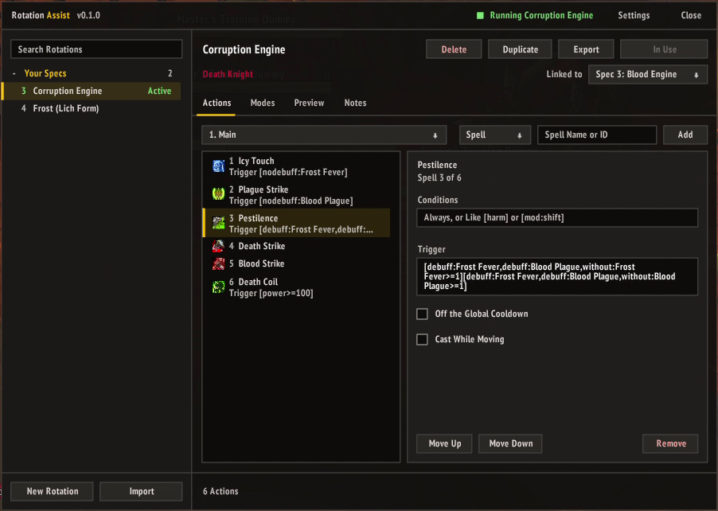
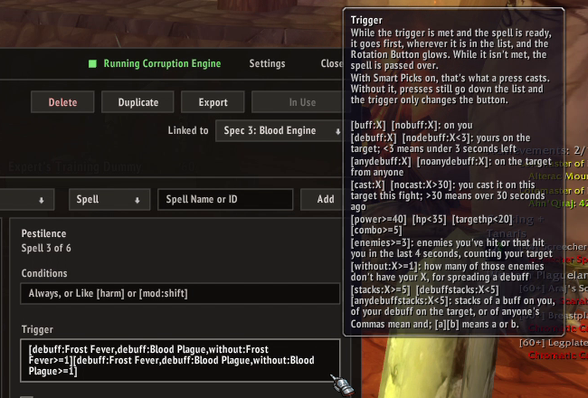
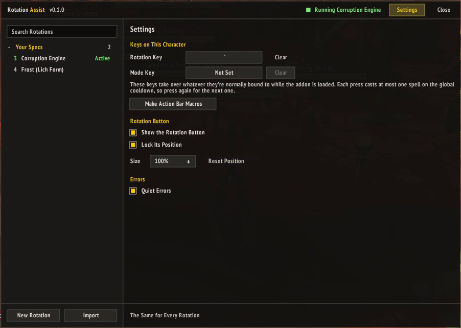
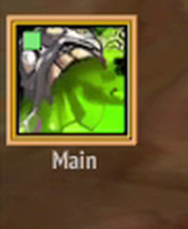
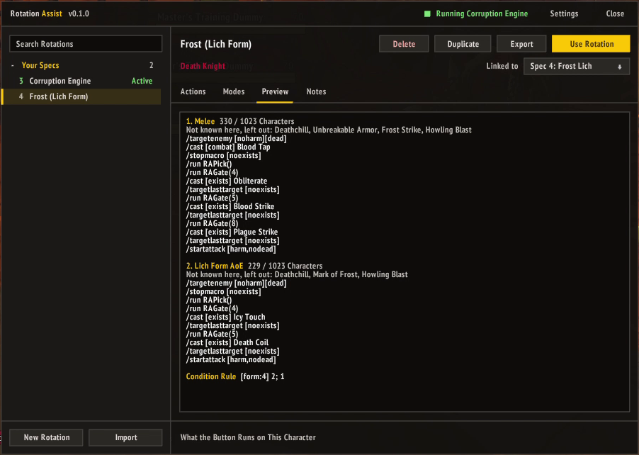
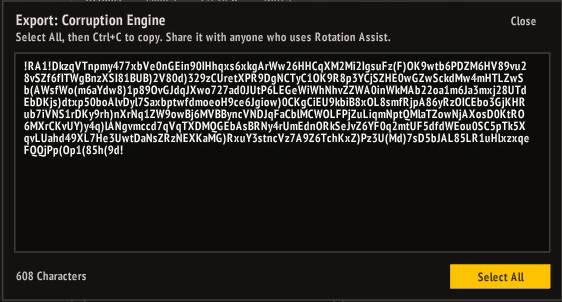

# Rotation Assist

One-button rotations for WoW 3.3.5a, made for accessibility.
Bind one key, or click one big on-screen button, and each press casts the first spell in your priority list that's
ready. It's an alternative to the GSE backports, built around what a 3.3.5a macro can really do, with an editor
in game and a button that shows what the next press casts.

## Features

- **Priority Lists:** each press tries your actions from the top down and casts the first one that's ready. A
  press during the global cooldown does nothing, so mashing the key is safe.
- **Modes:** keep separate lists, like single target and AoE, or one for a form. Switch with a Mode key that can
  also cast a spell on the way, or automatically with a macro condition rule.
- **Triggers:** give a spell a trigger like `[buff:Clearcasting]` or `[nodebuff:Corruption<3]`. While it's met
  and the spell is ready, the spell goes first and the Rotation Button glows; while it isn't, the spell is passed
  over. Triggers can check your buffs, your debuffs on the target, power, health, combo points, stacks, debuffs
  from anyone, how many enemies are in the fight, and how many of them are missing your debuff. With Smart Picks
  on, a press casts what the button shows; without it, triggers only change the button.
- **Smart Picks:** each press casts the spell the Rotation Button shows: the first one that's really ready
  (cooldowns, runes, power, combo points for finishers, range, and no cast times while you move), with any ready
  spell whose trigger is met going first. So a rotation can react to procs, debuffs, runes and cooldowns.
- **One Spell per Press:** for spells a plain list can't get past, like ones waiting on runes. Each press tries the
  next spell in a cycle that returns to the top ones most often (1, 1 2, 1 2 3...), like GSE's Priority
  sequences, so mashing the key gives every spell its turn.
- **Off-GCD Lines:** trinkets, racials and cooldowns like Icy Veins or Recklessness fire alongside the main spell.
- **Sequences and Steps:** `/castsequence` blocks, and Steps blocks that run one line per press. A sequence
  can be **Once per Reset**: it casts each spell once (a debuff, a mark), then waits until a new target or the
  next fight.
- **Rotation Button:** a large on-screen button showing the likely next spell, the mode and the key. You can
  click it like the key, and resize or move it. A green dot lights on it and on the minimap button while presses
  keep coming, from the key, clicks or a mouse macro, and goes out a second after the last one, so a repeating
  mouse macro left on is easy to spot.
- **Import and Export:** share a rotation, with all its modes, actions, triggers and notes, as one string.
- **Quiet Errors:** hides the "Not ready yet" errors that a priority list causes on purpose.
- **Per Spec:** link a rotation to a talent spec, and it switches with your spec.
- **Preview:** see exactly which macro each mode runs on your character, and which spells were left out
  because you don't know them.
- **Themes:** the flat Material look, Classic for the game's own frames and buttons, or Cognac's painted gold
  frames on dark glass. Pick one from **Theme** in the window's title bar; it applies after a reload, which
  Rotation Assist offers to do for you.

## What a Button Can and Can't Do on 3.3.5a

The game decides what an addon may do in combat, and in 3.3.5a addons can't choose spells while you fight.
Instead, the button runs a macro built before the fight. The macro skips any spell that can't be cast: one on
cooldown, one you lack the rage or mana for, a reactive ability that isn't lit (Execute, Overpower, Kill Shot), or
one out of range. It casts the first one left. Death Knight spells waiting on runes are the exception: the first
one stops the whole press, which is what One Spell per Press is for.

So a plain list can't react to procs, buffs, debuffs or target health. If something a macro condition can see
changes (a form, a stance, a modifier key, your target), a condition rule can switch modes. For a buff, use the
Mode key. Every cast still needs a key press.

Smart Picks gets around this with a target trick. Before a line that would cast instead of the spell it picked,
it clears your target for an instant, so that line (conditioned on `[exists]`) can't cast, then retargets right
after. Lines that can't cast anyway, and lines after the pick, keep the target, so most presses don't touch it.
What that means in play:

- Target frames can flicker on the presses that do clear.
- It needs an enemy targeted, so it's a poor fit for healing or buffing friends. Use One Spell per Press or a
  plain list there.
- When nothing looks ready, a press runs the list in order, still skipping spells whose trigger isn't met. Keep a
  filler with no trigger at the end so there's always something to cast.
- The first clear in a fight prints "Interface action failed because of an AddOn" in chat, once per session.
  The target still clears, so it's safe to ignore.

## Installation

1. Download the latest release.
2. Extract the `RotationAssist` folder into `World of Warcraft\Interface\AddOns`.
3. If your server has a module (see [Server Modules](#server-modules)), install it the same way.
4. Restart the game, or log out to the character screen and back in.

## Getting Started

1. Open the window with `/rota` or the minimap button and click **New Rotation**, or **Import** one
   someone shared.
2. On the **Actions** tab, drag spells in from your spellbook or type their names, and order them from most to
   least important. Mark trinkets and other off-GCD actions as **Off the Global Cooldown**.
3. In **Settings** (top right of the window), set the **Rotation Key** (and a **Mode Key** if you use modes), or
   make the action bar macros.
4. Click **Use Rotation** to link it to your active spec.

Changes made in combat apply as soon as combat ends. For a step-by-step walkthrough, read on.

## Building a Rotation

This guide builds a Fire Mage rotation, but the steps are the same for any class. The pictures show Death Knight
rotations.

### 1. List Your Spells, Most Important First

Click **New Rotation**, name it, and add your spells on the **Actions** tab. Drag them from your spellbook, or
type a name and click **Add**. Put them in the order you'd want them if everything were ready at once: big
cooldowns and procs near the top, your filler spell last. Drag an action up or down the list to change its place;
on the **Modes** tab, drag a mode by the grip beside its number.

| # | Spell         | Why it's here                               |
|---|---------------|---------------------------------------------|
| 1 | Combustion    | A cooldown; mark it Off the Global Cooldown |
| 2 | Pyroblast     | Only worth casting when Hot Streak procs    |
| 3 | Living Bomb   | Keep it on the target                       |
| 4 | Fireball      | The filler                                  |

Select an action to change it. **Off the Global Cooldown** lets a line fire alongside whatever else casts on that
press, which suits trinkets, racials and cooldowns like Combustion. **Conditions** takes macro conditions; put
`[@player]` there to cast a spell on yourself, like Power Word: Shield, while you have an enemy targeted. With
Smart Picks, these also go out of combat with nothing targeted, so you can buff before a pull.

### 2. Choose How a Press Works

On the **Modes** tab, pick one of three ways to run the list:

| Setting                 | What a press does                              | Good for                                       |
|-------------------------|------------------------------------------------|------------------------------------------------|
| Neither (a plain list)  | Casts the first spell the game lets it cast    | Simple lists, healing, anything friendly       |
| **Smart Picks**         | Casts the spell the Rotation Button shows      | Procs, debuffs to keep up, most damage         |
| **One Spell per Press** | Tries one spell per press, top ones most often | Healing or no target, when a plain list stalls |

Smart Picks is the one that lets triggers (next step) decide what casts, so turn it on for a damage rotation.
Also turn on **Target the Nearest Enemy** and **Start Auto-Attack** if you want a press to pick a target and start
attacking for you.

![The Modes tab: a Melee mode and a Lich Form AoE mode switched by the condition rule [form:4] 2; 1, with Target the Nearest Enemy, Start Auto-Attack and Smart Picks on](docs/images/modes.png)

### 3. Add Triggers

A plain list can't see buffs or debuffs, so Pyroblast would go off without Hot Streak, and Living Bomb would be
recast while it's still ticking. A trigger fixes that. Select the spell and fill in **Trigger**:

| Spell       | Trigger                  | Means                                                     |
|-------------|--------------------------|-----------------------------------------------------------|
| Pyroblast   | `[buff:Hot Streak]`      | Only when Hot Streak is up, and then before anything else |
| Living Bomb | `[nodebuff:Living Bomb]` | Only when your Living Bomb isn't on the target            |

While a spell's trigger is met, it jumps the queue and the Rotation Button glows. While it isn't, the spell is
skipped. A spell with no trigger is always a candidate. Some more you can use:

- `[nodebuff:X<3]`: your debuff is missing or has under 3 seconds left, to refresh before it falls off
- `[nobuff:X]`: a self-buff is missing
- `[noselfdebuff:X]`: a debuff isn't on you, like Weakened Soul before a Power Word: Shield
- `[power>=60]`, `[hp<35]`, `[targethp<20]`, `[combo>=5]`: power, your health, the target's health, combo points
- `[stacks:X>=5]`, `[debuffstacks:X<5]`: stacks of a buff on you, or of your debuff on the target
  (`anydebuffstacks` counts anyone's)
- `[noanydebuff:X]`: nobody's debuff is on the target, like a shared Faerie Fire
- `[nocast:X]`: you haven't cast it on this target this fight, for spells that leave no aura to see
- `[enemies>=3]`: three or more enemies in the fight (ones you've hit or that hit you in the last few seconds)
- `[without:X>=1]`: at least one enemy in the fight is missing your X, for a spell that spreads it
- `[a, b]` means a and b; `[a][b]` means a or b

Hover over the Trigger box in game for the full list.

### 4. Handle AoE

The easy way is one mode: add your AoE spell with an `[enemies>=3]` trigger, say Flamestrike, near the top. It
takes over on packs and steps aside on single targets.

For a whole different list, add a second mode on the **Modes** tab and fill it on the Actions tab (pick the mode
from the dropdown at the top). Then choose how to switch: a **Mode Key** you press, or a **Condition Rule** that
follows a form, stance or modifier key, like `[mod:shift] 2; 1` for mode 2 while Shift is held.

### 5. Bind It and Test

1. In **Settings**, set the **Rotation Key** (and the Mode Key if you use one).
2. Click **Use Rotation** so your spec runs it.
3. Find a training dummy and mash the key. Watch the Rotation Button: it shows the spell the next press should
   cast, glows when a trigger picked it, and shows a green dot while presses keep coming.
4. If a spell never goes, or goes too often, check its trigger and its place in the list. `/rota trace` prints the
   spell each press picked and what it tried, and the **Preview** tab shows the exact macro each mode runs. A spell
   the game refuses (like Power Word: Shield under Weakened Soul) is passed over for a couple of seconds, so it
   can't stall the rotation, but a trigger that keeps picking it still costs a press now and then.

When you're happy with it, click **Export**, next to Duplicate at the top of the rotation, to share it as a
string. To use one someone shared, click **Import** at the bottom of the rotation list and paste it in.

### Tips

- Fewer, well-ordered spells beat a long list. Leave out anything you'd only cast by hand.
- A spell you can't cast yet (not learned, wrong spec) is left out of the macro. The Preview tab lists those.
- Smart Picks passes over spells with a cast time while you move, and finishers until you have combo points.
  For a spell you can cast on the move anyway, like Pyroblast with a `[buff:Hot Streak]` trigger, turn on
  **Cast While Moving**.
- A macro holds 1023 characters, and each Smart Picks spell takes about 50 more than a plain one. The Preview tab
  shows each mode's length and warns when one is over.

## Commands

`/rotationassist` works everywhere `/rota` does.

- `/rota`: open or close the window
- `/rota button`: show or hide the Rotation Button
- `/rota lock`, `/rota unlock`: lock or unlock the Rotation Button's position
- `/rota macros`: make the RA Rotation and RA Mode macros
- `/rota quiet`: turn Quiet Errors on or off
- `/rota trace`: after each press, list the spells sent, cast or failed, and the errors, to see which line took
  the press
- `/rota minimap`: show or hide the minimap button (drag it around the minimap, or Shift-drag it anywhere on
  screen)
- `/rota minimap reset`: put the minimap button back on the minimap
- `/rota reset`: move the window back to the top middle of the screen, and the Rotation Button back under the
  middle
- `/rota theme <name>`: switch the theme after a reload: `material`, `classic` or `cognac`
- `/rota pixel`: turn pixel snapping off or back on

The window snaps to whole screen pixels, so its borders stay crisp. At most UI scales that makes it a little
larger or smaller than the rest of your UI; `/rota pixel` turns it off if you'd rather it matched exactly.

With a LibDataBroker display such as Titan Panel or ElvUI's data texts, Rotation Assist appears there too, with
the same clicks as the minimap button.

## Server Modules

Rotation Assist works on any 3.3.5a server as it is. Servers that change the game (several classes per
character, named specs, custom spells with rune costs or combo points) can have a small module addon that tells
it about those changes. Install a module next to Rotation Assist; it loads after it.

| Server    | Module                                                                              |
|-----------|-------------------------------------------------------------------------------------|
| Synastria | [RotationAssist-Synastria](https://github.com/iExpulsion/RotationAssist-Synastria) |

To write one for your server, read [docs/MODULES.md](docs/MODULES.md).

## License

MIT. Bundles [LibDeflate](https://github.com/SafeteeWoW/LibDeflate) (zlib License) to compress rotation
strings, LibStub and LibDataBroker-1.1 (public domain), and CallbackHandler-1.0 (from Ace3, under its own
BSD-style license). The Cognac art in `RotationAssist/UI/Skins/Cognac` is from
[AttuneNext](https://github.com/speedyrulz/AttuneNext) and isn't covered by the MIT License.
